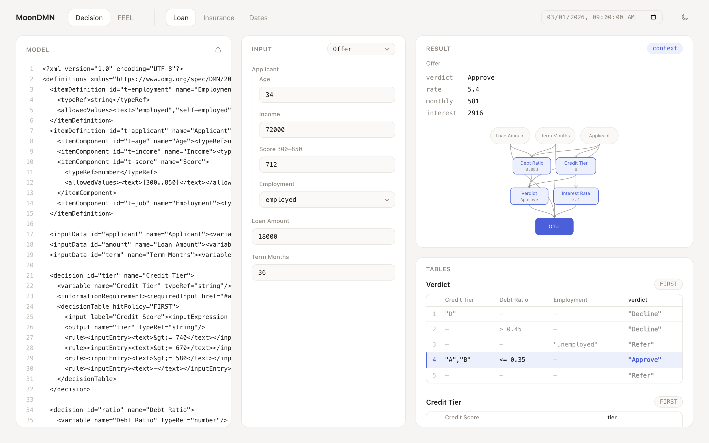

# MoonDMN

**[在线 Playground](https://sundaysebasidian-byte.github.io/moondmn/)**

<picture>
  <source media="(prefers-color-scheme: dark)" srcset="docs/assets/playground-dark.png">
  
</picture>

MoonDMN 是用 MoonBit 从零写的 OMG DMN 1.5 决策引擎和 FEEL 表达式求值器。
不依赖 JVM，能编译到 native、wasm-gc 和 js，并用官方 DMN TCK 逐例验证。

English: a from-scratch DMN 1.5 decision engine and FEEL evaluator in MoonBit. It runs without a JVM,
compiles to native, wasm-gc and JavaScript, and is checked case by case against the official DMN TCK
(Level 2: 116/116, Level 3: 3251/3291).

- 仓库：https://github.com/sundaysebasidian-byte/moondmn
- 许可证：Apache-2.0，第三方组件见 [NOTICE](NOTICE)
- 一致性结果：[docs/conformance.md](docs/conformance.md)
- 设计说明：[docs/design.md](docs/design.md)

## 适用场景

- 业务规则：审批、定价、风控、资格判定这类需要审计、需要版本管理的决策逻辑。
- 跨平台嵌入：同一份 DMN 模型可以跑在服务端（native）、浏览器和插件（wasm-gc）、Node 和前端（js）。
- 规范学习：精确十进制、三值逻辑、时区和区间语义都有可执行的示例和测试。
- 回归验证：官方 TCK 是端到端回归，语义一改，通过数就会变。

## Playground

Playground 是纯静态页面，没有框架也没有 CDN，引擎在浏览器里直接运行。

- 左：DMN XML 编辑器。可以粘贴、点上传按钮，或把文件拖进来。解析错误和 lint 告警列在下方，点一条会定位到对应行。
- 中：按 InputData 和 ItemDefinition 自动生成的输入表单。支持数字、文本、日期、时间、日期时间、时长、布尔、枚举（`allowedValues`）、嵌套结构和集合。
- 右：结果、决策依赖图（DRG）和决策表。图里点一个决策就求值它；决策表高亮命中的规则行并标出命中策略，点规则行会跳到 XML 对应位置。
- 顶部的 FEEL 标签页求单行表达式并显示结果类型。右上角的时间输入框是 `now()`、`today()` 用的时钟。

内置贷款审批、保险定价（UNIQUE、COLLECT、PRIORITY、ANY、RULE ORDER、FIRST）、日期与时长计算三个示例，都是自己写的，不含 TCK 文件。

本地构建和运行：

```bash
scripts/build-web.sh
node web/smoke.mjs
python3 -m http.server -d web/dist 8000
```

然后打开 http://localhost:8000/。`scripts/build-web.sh` 把 `playground` 包编译为 js，输出到 `web/dist`；
`web/smoke.mjs` 直接调用导出函数，对三个示例的结果、命中规则和 lint 做断言。导出函数的参数和返回值见 [docs/api.md](docs/api.md)。
推送到 main 后由 `.github/workflows/pages.yml` 部署到 GitHub Pages。

## 环境要求

- MoonBit 工具链 0.1.20261028 或更新版本（`moon version --all` 查看）。
- 首次构建会从 mooncakes 拉取 `Milky2018/xml` 和 `moonbitlang/x`。
- 运行 Playground 的冒烟测试需要 Node.js（CI 使用 22）。

```bash
export PATH="$HOME/.moon/bin:$PATH"
moon version
moon build
```

## 安装与接入

在已有 MoonBit 模块中安装：

```bash
moon add sundaysebasidian-byte/moondmn@0.1.0
```

从源码构建并运行 CLI：

```bash
git clone https://github.com/sundaysebasidian-byte/moondmn.git
cd moondmn
moon build
moon run cmd/main -- feel 'sum([1, 2, 3]) * 2'
```

输出：

```text
12
```

发布后计划支持 `moon add sundaysebasidian-byte/moondmn@0.1.0`。现在要在自己的 MoonBit 项目里用，
把本仓库放进同一个 workspace，并在包里添加：

```text
import {
  "sundaysebasidian-byte/moondmn",
}
```

之后就能调用 `@moondmn.feel_eval`、`@moondmn.parse_model` 等。完整示例见 [`examples/api-demo`](examples/api-demo)：

```moonbit
fn main {
  let result = @moondmn.feel_eval("sum([1, 2, 3]) * 2") catch {
    @types.Failure(_, _, _, message) => "error: " + message
  }
  println(result) // 12
}
```

```bash
moon run examples/api-demo
```

## 命令行

命令输出 JSON 或纯文本。失败时输出 `{"error": "...", "message": "..."}`（带行列号），退出码为 1。

### feel：求值表达式

```bash
moon run cmd/main -- feel 'Applicant Age >= 18' --context examples/input.json
```

```text
true
```

```bash
moon run cmd/main -- feel 'list replace([1, 2, 3], 2, 4)'
```

```text
[1,4,3]
```

`now()` 和 `today()` 需要显式给时钟：`--now 2024-02-29T23:30:00-05:00`。

### eval：执行模型里的决策

```bash
moon run cmd/main -- eval examples/eligibility.dmn \
  --decision Eligible --input examples/input.json
```

```text
true
```

### lint：静态检查

检查未定义的引用，以及决策表规则重叠和缺口。

```bash
moon run cmd/main -- lint examples/eligibility.dmn
```

```text
[]
```

### tck：运行官方用例

```bash
./scripts/fetch-tck.sh
moon run cmd/main -- tck .tck/TestCases/compliance-level-2 \
  --json evidence/tck-level-2.json
moon run cmd/main -- tck .tck/TestCases/compliance-level-3 \
  --json evidence/tck-level-3.json
```

不加 `--json` 会把完整报告打印到标准输出：

```bash
moon run cmd/main -- tck .tck/TestCases/compliance-level-3/0068-feel-equality
```

## 覆盖矩阵

| 能力 | 状态 | 说明 |
| --- | --- | --- |
| FEEL 精确十进制 | 已支持 | 34 位、半偶舍入、scale [-6111,6176]；超越函数仍用有限精度浮点桥接 |
| 三值逻辑与 null 相等 | 已支持 | `and`/`or`/`not`、FEEL 相等规则 |
| 日期、时间、时长、时区 | 部分支持 | 时区只内置 IANA 2026e 的 39 个名称、1970–2100 年；范围外报错，DST gap 报错、overlap 取较早时刻；详见 conformance |
| 列表、上下文、区间 | 部分支持 | 支持常用操作；开闭区间边界、重复键等仍有 TCK 失败 |
| 过滤器、路径、迭代器 | 部分支持 | 路径按已知键识别多词名称；item 遮蔽、缺字段与非法 domain 处理仍有失败 |
| 用户函数与 BKM | 部分支持 | 命名缺参绑定 null；部分类型/输出适配仍有失败 |
| 决策表 | 部分支持 | 全部 hit policy 可用；复杂模型和 inputVariable 匹配仍有失败 |
| lint | 部分支持 | 未定义引用、重复规则、可能的缺口；输入域有限（枚举 `allowedValues`，最多 4096 个组合）且被证明完整覆盖时不告警，开放域仍提示 |
| 决策服务与 DRG | 部分支持 | 依赖求值与输出集合可用；服务参数顺序/类型适配仍有失败 |
| 类型系统 | 部分支持 | 根包/CLI/Playground 共用声明时态 JSON 转换；结构类型/隐式转换仍有失败 |
| 内置函数 | 部分支持（约 90 个） | 剩余逐例缺陷和受限函数见 docs/conformance.md |
| `now()` / `today()` | 已支持（需注入时钟） | API 的 clock 参数、CLI 的 `--now`；不注入则报不支持 |
| 正则 `s`/`x`/`m` 标志 | 部分支持 | 基础匹配可用，仍有 Unicode 折叠和 XPath 正则语法差异 |
| 外部 Java 函数 | 明确不支持 | 需要 JVM |
| DMN 1.5 `import` | 明确不支持 | 多文件导入尚未实现 |

## 一致性结果

固定提交 `1e349176e5ae689d924a2a2c7a8df25c220d8b07` 的官方 TCK，本地实测：

| 级别 | 用例数 | 通过 | 通过率 |
| --- | --- | --- | --- |
| Level 2 | 116 | 116 | 100.0% |
| Level 3 | 3291 | 3251 | 98.78% |

目标是 Level 2 ≥ 95%、Level 3 ≥ 80%。Level 3 剩余 40 个失败：7 个是已知缺陷，25 个未实现
（Java 外部函数 18、`import` 7），2 个覆盖边界，2 个规范与 TCK 存在差异，4 个因 TCK 驱动不提供时钟。
也就是说，失败的大头是引擎自己的缺陷，不是范围外的用例。
结论、逐套件矩阵、逐例失败原因和复现步骤见 [docs/conformance.md](docs/conformance.md)，逐例原始报告在 [`evidence/`](evidence)。

## 和同类实现的区别

- 和 JVM 引擎（Camunda、Drools、KIE）比：MoonDMN 不依赖 JVM，可以编译到 wasm-gc 和 js；错误以结构化 JSON 返回，方便嵌入多语言服务。
- 和脚本语言实现比：四则运算和比较用精确十进制而不是浮点，金额计算不会有舍入偏差（`sqrt`、`log`、`exp` 仍经过浮点）；三值逻辑、null 相等和区间语义按 DMN 规范实现。
- 和只覆盖语法的项目比：仓库带 TCK 驱动和逐例报告，结论可以复现、可以审计。

## 开发与测试

```bash
moon fmt --check
moon check --deny-warn
moon test                 # native
moon test --target wasm-gc
moon test --target js
moon info                 # 重新生成 .mbti，提交后不应有差异
```

每个后端 271 个单元测试，另有 16 项 CLI 进程级检查（`python3 scripts/test-cli.py`）和 26 项 Playground 冒烟测试。

CI 在 Ubuntu、macOS、Windows 上执行上述检查，另有单独的 TCK 任务和 Playground 任务，
见 [`.github/workflows/ci.yml`](.github/workflows/ci.yml)。

## 限制与路线图

- 外部 Java 函数和 DMN 1.5 导入不在当前范围。
- TCK Level 3 还有 40 个失败，其中 7 个是已知缺陷，逐例列在 [docs/conformance.md](docs/conformance.md)。
- 时区只有 39 个名称，只覆盖 1970–2100 年。
- `now()`、`today()` 没有隐含的系统时钟，必须由调用方注入。
- 计划补齐正则标志和 `range()` 的高级参数。
- 部分隐式转换和函数元数据（`0103-feel-is-function`）还有差距。
- 决策表里的 FEEL 每次求值时重新编译，整表预编译还没做；性能数字见 [docs/performance.md](docs/performance.md)。
- Playground 的命中规则只覆盖决策自己的决策表，BKM 内的决策表不显示命中。

## 许可证

Apache License 2.0，见 [LICENSE](LICENSE)；上游项目和测试数据来源见 [NOTICE](NOTICE)。
